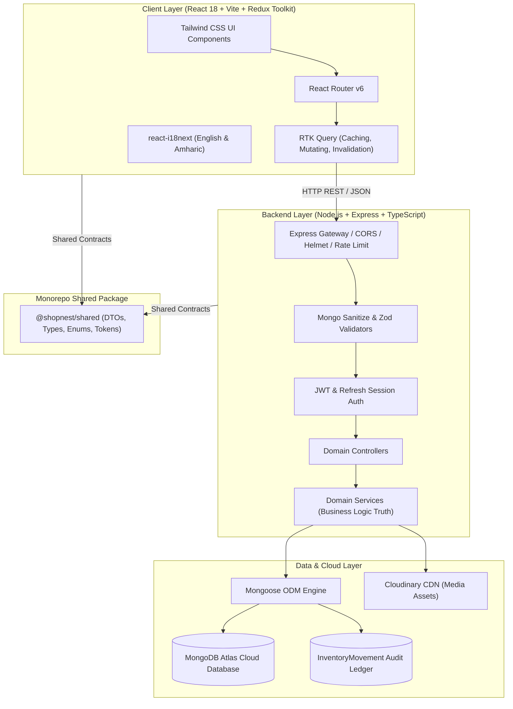
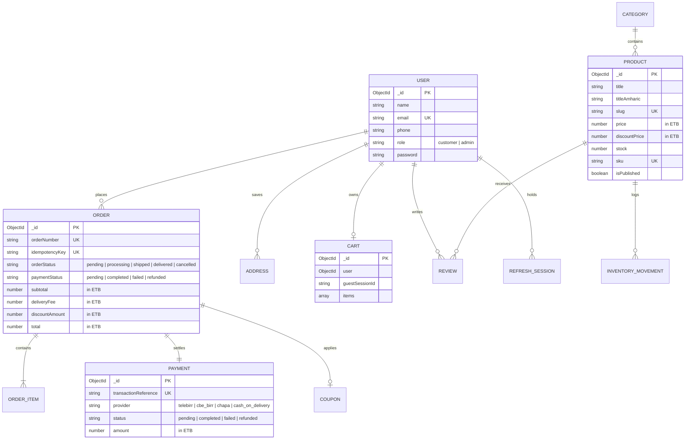

# 🛍️ ShopNest Ethiopia — Full-Stack MERN E-Commerce Platform

> **"Your Marketplace, Your Way."**  
> **"የእርስዎ የገበያ መድረክ"**

ShopNest Ethiopia is an enterprise-grade full-stack e-commerce application tailored specifically for the Ethiopian digital economy. Built strictly following production MERN standards, it features **bilingual English & Amharic support**, real-time **ETB (Ethiopian Birr)** currency pricing, native **Ethiopian mobile payment integration** (Telebirr, CBE Birr, Chapa, Cash on Delivery), strict **atomic inventory concurrency protections**, idempotent checkouts, and a unified design system.

---

## 🎨 Visual Identity & Design System

The visual design is implemented according to the Master Design Mockups:

| Token | Value | Application |
| :--- | :--- | :--- |
| **Primary Brand Orange** | `#F97316` | Action buttons, active badges, highlights, primary CTAs |
| **Deep Charcoal Text** | `#1F2937` | Headings, high-contrast labels, primary typography |
| **Secondary Gray** | `#6B7280` | Subtitles, helper text, borders, placeholders |
| **Neutral Background** | `#F9FAFB` | Soft application canvas, section backdrops |
| **Surface White** | `#FFFFFF` | Cards, modals, slide-overs, dropdown containers |
| **Crisp Border** | `#E5E7EB` | Dividers, inputs, card outlines |
| **Dark Theme Canvas** | `#0B0F19` | Deep OLED dark background with high legibility |
| **Dark Theme Surface** | `#111827` | Premium dark cards, drawers, and modal containers |
| **Typography** | Inter & Noto Sans Ethiopic | Clean Latin and authentic Amharic script rendering |

### 🌟 Key Enterprise Storefront Capabilities

- 🌓 **Dynamic Theme Engine (Dark & Light Mode)**: Seamless toggle in the header with local storage persistence (`shopnest_theme`), OS system-preference fallback, and curated contrast ratios matching `#0B0F19` dark mode standards.
- 📱 **Full Mobile Responsiveness & Bottom Navigation**: Pixel-perfect layout for phones, tablets, and desktops, including a fixed mobile navigation bar (Home, Shop, Cart, Wishlist, Account) with real-time badge counters.
- 🖼️ **Profile Picture Upload**: Interactive avatar file uploader with live preview, base64 payload serialization, instant synchronization to Redux and MongoDB Atlas (`PATCH /api/v1/auth/profile`), and header avatar display.
- ⚡ **Interactive Quick View Modal**: Quick-preview modal directly on product cards allowing instant photo inspection, Birr price calculation, live stock indicators, and quantity-controlled cart addition without page reload.

---

## 🏛️ System Architecture



---

## 🗄️ Database Entity Relationship Diagram (ERD)



---

## 📱 Implemented Pages & Features

### 🛒 Customer-Facing Pages
1. **Homepage (`/`)**: Hero carousel banner, category icons, featured products grid, Ethiopian coffee & Habesha banners, delivery trust value bar, customer footer.
2. **Shop / Product Catalog (`/shop`)**: Faceted category filters, price range slider (ETB 0 – 100,000+), stock availability filter, search by keyword, multi-attribute sorting (`price_asc`, `price_desc`, `rating`, `newest`, `popularity`), and pagination.
3. **Product Detail (`/product/:slug`)**: Multi-angle image thumbnails, ETB pricing, stock level indicators, quantity stepper, add-to-cart, wishlist toggle, specifications table, and authenticated customer reviews.
4. **Live Shopping Cart (`/cart`)**: Server-backed cart synchronization, real-time price & stock fluctuation warning banners, free shipping progress bar toward 2,500 ETB, guest cart persistence, and coupon validation.
5. **Multi-Step Checkout (`/checkout`)**:
   - Customer contact information with live Ethiopian mobile regex validation (`+2519...`, `09...`, `+2517...`, `07...`).
   - Delivery destination selector for all Ethiopian regions, cities, and Addis Ababa sub-cities (Bole, Kirkos, Yeka, Arada, etc.).
   - Saved address selector for authenticated customers.
   - Payment method selection: **Telebirr (ቴሌብር)**, **CBE Birr (ሲቢኢ ብር)**, **Chapa (ቻፓ)**, and **Cash on Delivery**.
   - Interactive Simulated Payment Sandbox for developer testing.
   - Client-side `Idempotency-Key` headers preventing accidental double-charging.
6. **Customer Account Portal (`/account`)**: Sidebar navigation, dashboard overview metrics (total orders, saved wishlist items, total spent in ETB), recent orders list, saved delivery addresses manager, and profile settings.
7. **Order Tracking History (`/account/orders`)**: Filterable orders list with detailed tracking modal, delivery coordinates, line items breakdown, and payment status badges.
8. **Customer Wishlist (`/wishlist`)**: Instant save/remove with live stock availability and direct add-to-cart.
9. **Informational & Support Pages**:
   - **About Us (`/about`)**: Mission, authenticity guarantees, and Addis Ababa headquarters.
   - **Contact Support (`/contact`)**: Support inquiries, Ethiopian phone hotline, and email.
   - **Help & FAQ (`/faq`)**: Common delivery questions, payment guides, and warranty FAQs.
   - **Shipping & Delivery Policy (`/shipping-policy`)**: Addis Ababa standard fee (150 ETB), regional fee (250 ETB), and free shipping threshold (2,500 ETB).
   - **Return & Refund Policy (`/returns-policy`)**: 7-day satisfaction guarantee and Telebirr/CBE Birr refund handling.
   - **Privacy Policy (`/privacy-policy`)**: Ethiopian data privacy standards.
   - **Terms & Conditions (`/terms`)**: Platform conditions and dispute resolution.
10. **Error Boundaries & Access Fallbacks**:
    - **404 Not Found (`*`)**: Responsive route fallback.
    - **Access Denied (`/access-denied`)**: 403 Forbidden page for restricted administrative areas.
    - **Global Error Boundary**: Graceful React crash recovery.

### 🛡️ Administrative Portal (`/admin`)
- **Executive Analytics Dashboard**: Gross revenue in ETB, order volumes, active customers count, low-stock inventory alerts, and sales trend chart.
- **Order Management**: Real-time status transitions (`pending` → `processing` → `shipped` → `delivered` → `cancelled`) with instant customer synchronization.
- **Inventory & Audit Trail**: Real-time stock counts and immutable movement ledger (`stock_in`, `stock_out`, `order_reservation`).
- **Customer Directory**: Registered users list with role management.

---

## 🔒 Core Business Rules & Security

1. **Backend Pricing Truth**: Product prices, coupon discounts, delivery fees, and order totals are calculated exclusively on the backend. Client-submitted prices are completely disregarded.
2. **Concurrency & Overselling Prevention**: Product inventory is decremented using **atomic conditional database updates** (`findOneAndUpdate` with `{ stock: { $gte: quantity } }`). An optimistic reservation ledger triggers automated compensation rollback if any item in a multi-item cart fails.
3. **Idempotent Order Submissions**: Client orders send an `Idempotency-Key` header mapped to a unique sparse index in MongoDB, preventing accidental double billing.
4. **Authentication Security**:
   - Passwords hashed with `bcryptjs` (10 rounds) and protected with `select: false`.
   - Access tokens (15-minute TTL) paired with rotated Refresh Tokens (7-day TTL) stored in secure `HttpOnly`, `SameSite: strict` cookies.
   - Automatic compromise detection invalidates all active sessions upon refresh token reuse.
5. **NoSQL Injection & Rate Limiting**: Input sanitized with `express-mongo-sanitize`; sensitive endpoints protected with `express-rate-limit`.

---

## 🚀 Quick Start & Local Development

### 1. Prerequisites
- **Node.js**: v18.0.0 or later (v20+ recommended)
- **npm**: v9.0.0 or later
- **MongoDB**: Local MongoDB instance or MongoDB Atlas URI

### 2. Installation
Clone repository and install monorepo dependencies:
```bash
git clone https://github.com/your-username/shopnest-ethiopia.git
cd shopnest-ethiopia
npm install
```

### 3. Environment Configuration
Copy the template files:
```bash
cp server/.env.example server/.env
cp client/.env.example client/.env
```

### 4. Database Seeding (32+ Products, Categories & Demo Data)
Run the idempotent seeding engine:
```bash
# Seed 8 categories, 32 products, coupons, and sample users
npm run seed

# Or wipe previous demo records and seed cleanly:
npm run seed:clean
```

### 5. Provision Administrator Account
Securely create or elevate an admin user without hardcoded secrets:
```bash
npm run provision-admin -- --email=admin@shopnest.et --password=YourSecurePassword2026! --name="Abebe Admin" --phone="+251911000000"
```

### 6. Run the Application
Start both server and client concurrently:
```bash
npm run dev
```
- **Frontend Storefront**: [http://localhost:5173](http://localhost:5173)
- **Backend API Gateway**: [http://localhost:5000](http://localhost:5000)
- **Swagger / OpenAPI Documentation**: [http://localhost:5000/api/docs](http://localhost:5000/api/docs)
- **API Health Check**: [http://localhost:5000/api/health](http://localhost:5000/api/health)

---

## 🧪 Automated Testing & Verification

The project includes an end-to-end testing suite spanning unit, integration, and UI component tests:

```bash
# Run all automated tests across workspaces
npm test

# Run backend integration tests (48 tests)
npm run test:server

# Run frontend component tests (11 tests)
npm run test:client

# Full TypeScript strict type-check (zero errors)
npm run type-check

# Full production build bundle validation
npm run build
```

### Test Coverage Highlights
- ✅ **100% Pass Rate**: 59 automated test suites passing cleanly (48 server + 11 client).
- ✅ **Inventory Concurrency Tests**: Verified atomic inventory deduction, race condition handling, and rollback compensation.
- ✅ **Idempotency Deduplication**: Verified that duplicate requests return the original order safely.
- ✅ **Payment Sandbox Lifecycle**: Verified state transitions between pending, completed, and failed.
- ✅ **Ethiopian Localization**: Verified phone number format validation, regional delivery calculations, and Amharic translation rendering.

---

## 📖 In-Depth Technical Documentation

For complete architectural references and interview preparation:
- 🏗️ **[System Architecture & Design (docs/ARCHITECTURE.md)](docs/ARCHITECTURE.md)**
- 📡 **[REST API Specification & Endpoints (docs/API.md)](docs/API.md)**
- ☁️ **[Production Cloud Deployment Guide (docs/DEPLOYMENT.md)](docs/DEPLOYMENT.md)**
- 💡 **[Engineering & Interview Guide (25+ Q&A) (docs/INTERVIEW_GUIDE.md)](docs/INTERVIEW_GUIDE.md)**
- ⚙️ **[Environment Variables Reference (docs/ENVIRONMENT.md)](docs/ENVIRONMENT.md)**

---

## 📄 License
Private Portfolio Project — **ShopNest Ethiopia**. All rights reserved.
