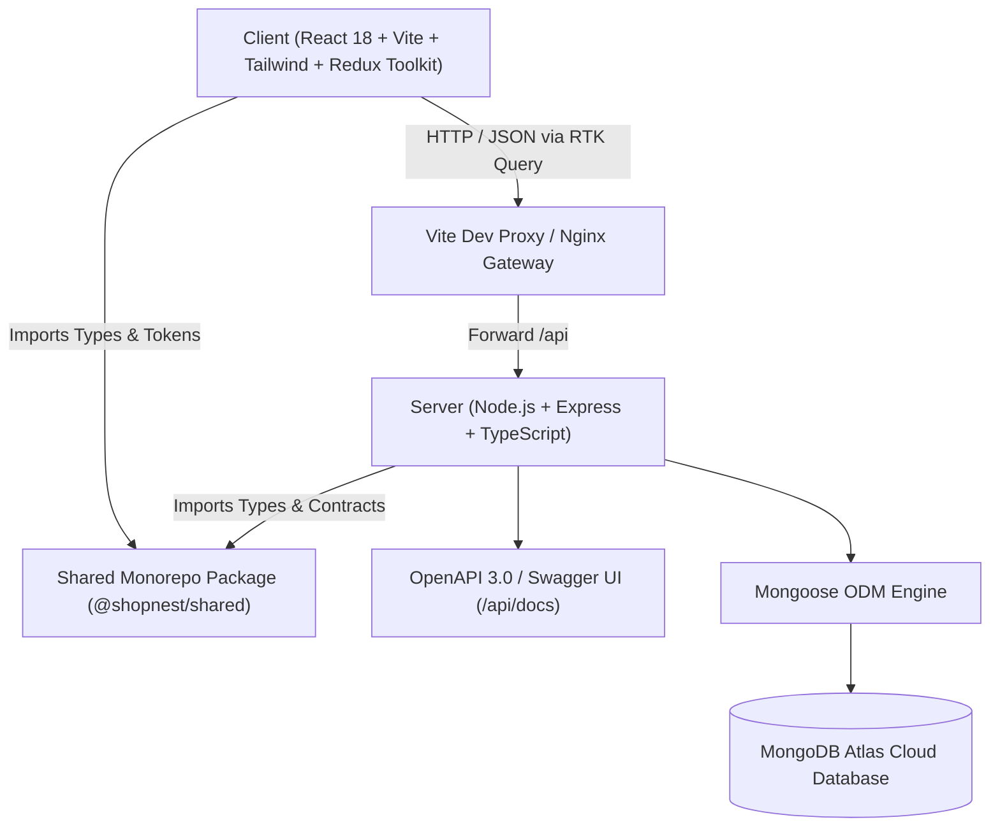
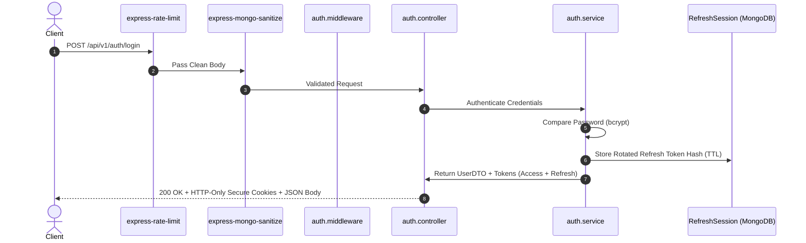

# ShopNest Ethiopia — Architecture & System Design

> **"Your Marketplace, Your Way."** / **"የእርስዎ የገበያ መድረክ"**

ShopNest Ethiopia is an enterprise-grade full-stack e-commerce portfolio application tailored for the Ethiopian market, featuring bilingual support (English & Amharic), scalable MERN architecture, strict TypeScript typing, Redux Toolkit state management, and real-time RTK Query API caching.

---

## 1. High-Level System Architecture

---

## 2. Backend Architecture & Authentication Pipeline

---

## 3. Database Schema Models (Mongoose)

| Model | Collection | Primary Responsibility & Indexes |
| :--- | :--- | :--- |
| `User` | `users` | Customer & Admin identities, Ethiopian phone validation, bcrypt password hashing, address book. Unique index on `email`. |
| `Category` | `categories` | Product hierarchy with English and Amharic names. Unique index on `slug`. |
| `Product` | `products` | E-commerce catalog, ETB pricing, stock tracking, Amharic translations. Text index on `title`, `titleAmharic`, `description`. |
| `Cart` | `carts` | User and guest session carts with quantity, price snapshots, and item calculations. Sparse unique indexes on `user` and `guestSessionId`. |
| `Order` | `orders` | Placed orders with Ethiopian delivery address, status tracking history, and ETB totals. Unique index on `orderNumber`. |
| `Payment` | `payments` | Telebirr, CBE Birr, Chapa, and Cash on Delivery transaction records. Unique index on `transactionReference`. |
| `Review` | `reviews` | Customer ratings (1-5) and feedback. Compound unique index on `{ product: 1, user: 1 }`. |
| `Wishlist` | `wishlists` | Saved products for authenticated customers. Unique index on `user`. |
| `Coupon` | `coupons` | Percentage and fixed discounts in ETB with usage limits and expiration dates. Unique index on `code`. |
| `InventoryMovement` | `inventorymovements` | Complete stock audit trail (`stock_in`, `stock_out`, `adjustment`, `order_reservation`). |
| `RefreshSession` | `refreshsessions` | JWT refresh tokens with rotation and compromise detection. MongoDB TTL index on `expiresAt`. |

---

## 4. Ethiopian Market Localization Rules

1. **Pricing**: All store prices, cart amounts, delivery fees, and order totals are calculated and stored in **Ethiopian Birr (ETB / Br)**.
2. **Mobile Validation**: Phone numbers must match Ethiopian mobile formats: `^(?:\+251|0)(?:9\d{8}|7\d{8})$` (supporting Ethio telecom and Safaricom Ethiopia).
3. **Delivery Addresses**: First-class support for Ethiopian administrative divisions: Region, City, Sub-city (Kifle Ketema in Addis Ababa), Woreda, House Number, and Local Landmark.
4. **Timezone**: All business-facing date formatting adheres to `Africa/Addis_Ababa` (UTC+3).
5. **Payment Systems**: Native identifiers for Telebirr, CBE Birr, Chapa, and Cash on Delivery.

---

## 5. Security & Engineering Standards

- **Strict TypeScript**: `noImplicitAny: true`, strict null checks, and typed DTOs across the monorepo.
- **Password Security**: Passwords hashed with bcrypt (salt rounds: 10), excluded from queries by default (`select: false`), never exposed in API responses.
- **Token Rotation**: Refresh tokens use cryptographic hashes stored in MongoDB with automatic reuse detection.
- **NoSQL Injection Prevention**: `express-mongo-sanitize` strips prohibited operators (`$`, `.`) from request bodies and query parameters.
- **Rate Limiting**: Authentication endpoints are rate-limited to 20 attempts per 15 minutes per IP.
- **Interactive API Docs**: Swagger UI mounted on `/api/docs` with complete OpenAPI 3.0 specs.
