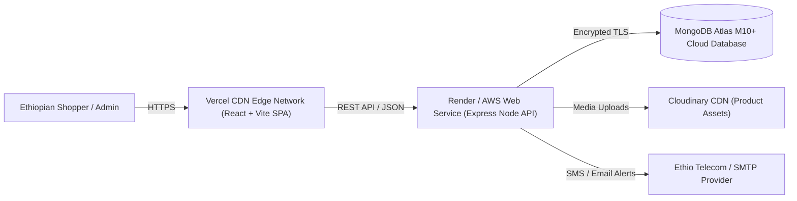

# ShopNest Ethiopia — Production Deployment & Cloud Infrastructure Guide

> **"Your Marketplace, Your Way."** / **"የእርስዎ የገበያ መድረክ"**

This guide provides end-to-end instructions for deploying ShopNest Ethiopia to production using **MongoDB Atlas**, **Render / Railway / AWS ECS** (Node.js API), and **Vercel / Netlify** (React Frontend).

---

## 1. Cloud Architecture Overview



---

## 2. Environment Variables Configuration

### A. Backend Server (`server/.env.production`)
| Variable | Recommended Production Value | Description |
| :--- | :--- | :--- |
| `NODE_ENV` | `production` | Enables production optimizations and disables stack traces in responses. |
| `PORT` | `5000` | Port assigned by the cloud platform environment. |
| `CLIENT_URL` | `https://shopnest-ethiopia.vercel.app` | Whitelisted CORS origin allowed to send credentials and cookies. |
| `MONGODB_URI` | `mongodb+srv://admin:<password>@cluster0.mongodb.net/shopnest_prod?retryWrites=true&w=majority` | Production MongoDB Atlas connection URI with TLS and retryable writes. |
| `JWT_ACCESS_SECRET` | `(64+ character random hex string)` | Cryptographic secret for signing access tokens. |
| `JWT_REFRESH_SECRET` | `(64+ character random hex string)` | Cryptographic secret for signing refresh tokens. |
| `ACCESS_TOKEN_TTL` | `15m` | Lifetime of short-lived access tokens. |
| `REFRESH_TOKEN_TTL` | `7d` | Lifetime of secure rotated refresh tokens. |
| `CLOUDINARY_CLOUD_NAME` | `your_production_cloud_name` | Cloudinary asset management container. |
| `CLOUDINARY_API_KEY` | `your_cloudinary_api_key` | Cloudinary public key. |
| `CLOUDINARY_API_SECRET`| `your_cloudinary_api_secret` | Cloudinary private authorization secret. |
| `PAYMENT_PROVIDER` | `production` / `simulated` | Set to `production` for real live banking gateway or `simulated` for demo sandbox. |

### B. Frontend Client (`client/.env.production`)
| Variable | Production Value | Description |
| :--- | :--- | :--- |
| `VITE_API_BASE_URL` | `https://api.shopnestethiopia.com/api` | Canonical production backend API root URL. |
| `VITE_DEFAULT_LOCALE` | `en` | Initial fallback locale (`en` or `am`). |

---

## 3. Database Deployment: MongoDB Atlas

1. **Create an Atlas Cluster**:
   - Log into [MongoDB Atlas](https://www.mongodb.com/cloud/atlas).
   - Create a dedicated cluster (M10+ recommended for production with automated backups and replica sets).
   - Select AWS or GCP region: `eu-central-1` (Frankfurt) or `af-south-1` (Cape Town) for optimal latency from Addis Ababa.
2. **Database Security & Network Access**:
   - Create a dedicated database user with `readWrite` permissions on database `shopnest_prod`.
   - Add your server's static outbound IP (or `0.0.0.0/0` with strong authentication) to Atlas IP Access List.
3. **Execute Seed & Index Provisioning**:
   ```bash
   MONGODB_URI="your_atlas_connection_string" npm run seed
   ```
4. **Provision Production Administrator**:
   ```bash
   ADMIN_EMAIL="security@shopnestethiopia.com" ADMIN_PASSWORD="StrongProductionPassword2026!" npm run provision-admin
   ```

---

## 4. Backend Deployment: Render / Railway / Docker

### Option A: Render Web Service
1. Connect your GitHub repository to [Render](https://render.com).
2. Create a new **Web Service**:
   - **Environment**: `Node`
   - **Root Directory**: Leave blank (monorepo root).
   - **Build Command**:
     ```bash
     npm run build:shared && npm run build:server
     ```
   - **Start Command**:
     ```bash
     npm run start --workspace=server
     ```
   - **Health Check Path**: `/api/health`
3. Add Environment Variables in the Render dashboard matching `server/.env.production`.

### Option B: Docker Container
A production multi-stage Dockerfile can be built and deployed to any container runtime:
```dockerfile
# Multi-stage production build
FROM node:20-alpine AS builder
WORKDIR /app
COPY package*.json ./
COPY shared/package*.json shared/
COPY server/package*.json server/
RUN npm ci
COPY shared/ shared/
COPY server/ server/
COPY tsconfig.base.json ./
RUN npm run build:shared && npm run build:server

FROM node:20-alpine AS runner
WORKDIR /app
ENV NODE_ENV=production
COPY package*.json ./
COPY server/package*.json server/
RUN npm ci --omit=dev
COPY --from=builder /app/shared/dist ./shared/dist
COPY --from=builder /app/shared/package.json ./shared/
COPY --from=builder /app/server/dist ./server/dist
EXPOSE 5000
CMD ["npm", "run", "start", "--workspace=server"]
```

---

## 5. Frontend Deployment: Vercel / Netlify

1. Connect your repository to [Vercel](https://vercel.com).
2. Select root directory: `client` (or set Root Directory to `.` and configure Output Directory to `client/dist`).
3. Set **Framework Preset**: `Vite`.
4. Configure Build and Output Settings:
   - **Build Command**: `npm run build --workspace=client`
   - **Output Directory**: `dist`
5. Configure SPA Fallback routing via `client/vercel.json`:
   ```json
   {
     "rewrites": [
       { "source": "/api/(.*)", "destination": "https://api.shopnestethiopia.com/api/$1" },
       { "source": "/(.*)", "destination": "/index.html" }
     ]
   }
   ```
6. Add `VITE_API_BASE_URL` in Vercel Project Settings.

---

## 6. Pre-Flight Production Verification Checklist

- [ ] All 59 automated test suites pass cleanly (`npm test`).
- [ ] TypeScript strict compilation succeeds across all packages (`npm run type-check`).
- [ ] CORS is restricted to canonical production frontend domains.
- [ ] MongoDB connection uses TLS (`mongodb+srv://...`).
- [ ] JWT secrets are at least 64 characters long and generated via `crypto.randomBytes(32).toString('hex')`.
- [ ] Production admin account has been provisioned with a secure password.
- [ ] Health check endpoint [https://api.shopnestethiopia.com/api/health](https://api.shopnestethiopia.com/api/health) returns HTTP 200 with database status `connected`.
